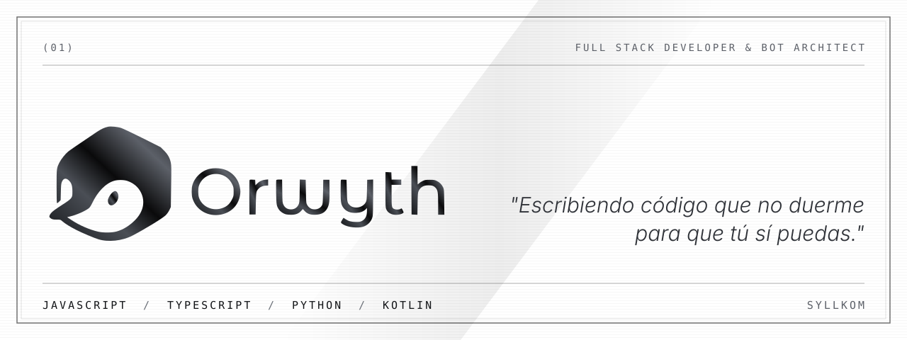
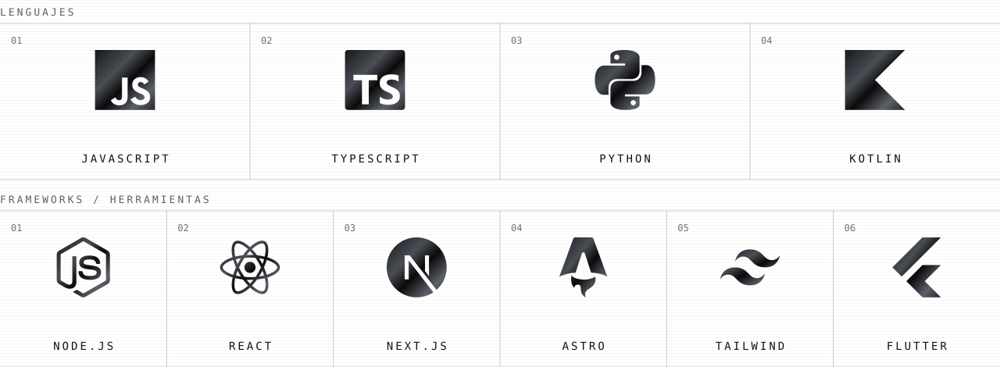
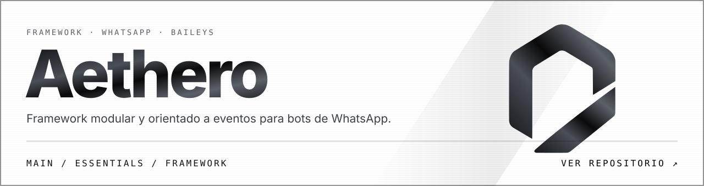

  <picture>
    <source media="(prefers-color-scheme: dark)" srcset="assets/dark/banner.svg">
    
  </picture>

  <picture>
    <source media="(prefers-color-scheme: dark)" srcset="assets/dark/h-stack.svg">
    
  </picture>

  <picture>
    <source media="(prefers-color-scheme: dark)" srcset="assets/dark/stack.svg">
    
  </picture>

  <picture>
    <source media="(prefers-color-scheme: dark)" srcset="assets/dark/h-work.svg">
    
  </picture>

  <a href="https://github.com/Syllkom/Aethero">
    <picture>
    <source media="(prefers-color-scheme: dark)" srcset="assets/dark/aethero-card.svg">
    
  </picture>
  </a>

  <picture>
    <source media="(prefers-color-scheme: dark)" srcset="assets/dark/h-stats.svg">
    
  </picture>

  <picture>
    <source media="(prefers-color-scheme: dark)" srcset="https://streak-stats.demolab.com?user=Syllkom&theme=dark&hide_border=true&background=0d1117&ring=c7cacf&fire=ffffff&currStreakNum=ffffff&sideNums=ffffff&currStreakLabel=c7cacf&sideLabels=8d9198&dates=6b6f76&border_radius=0">
    
  </picture>

  <picture>
    <source media="(prefers-color-scheme: dark)" srcset="https://github-readme-activity-graph.vercel.app/graph?username=Syllkom&area=true&hide_border=true&hide_title=true&bg_color=0d1117&color=ffffff&line=c7cacf&point=ffffff&area_color=8d9198">
    
  </picture>

  <picture>
    <source media="(prefers-color-scheme: dark)" srcset="assets/dark/h-contact.svg">
    
  </picture>

  <a href="https://orwyth.site"><picture>
      <source media="(prefers-color-scheme: dark)" srcset="assets/dark/c-portfolio.svg">
      
    </picture></a>
  <a href="https://t.me/Orwyth"><picture>
      <source media="(prefers-color-scheme: dark)" srcset="assets/dark/c-telegram.svg">
      
    </picture></a>
  <a href="https://www.threads.net/@orwyth"><picture>
      <source media="(prefers-color-scheme: dark)" srcset="assets/dark/c-threads.svg">
      
    </picture></a>

  <picture>
    <source media="(prefers-color-scheme: dark)" srcset="assets/dark/footer.svg">
    
  </picture>

